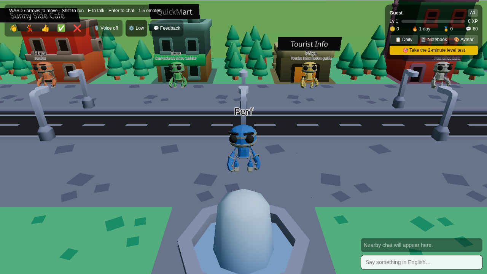
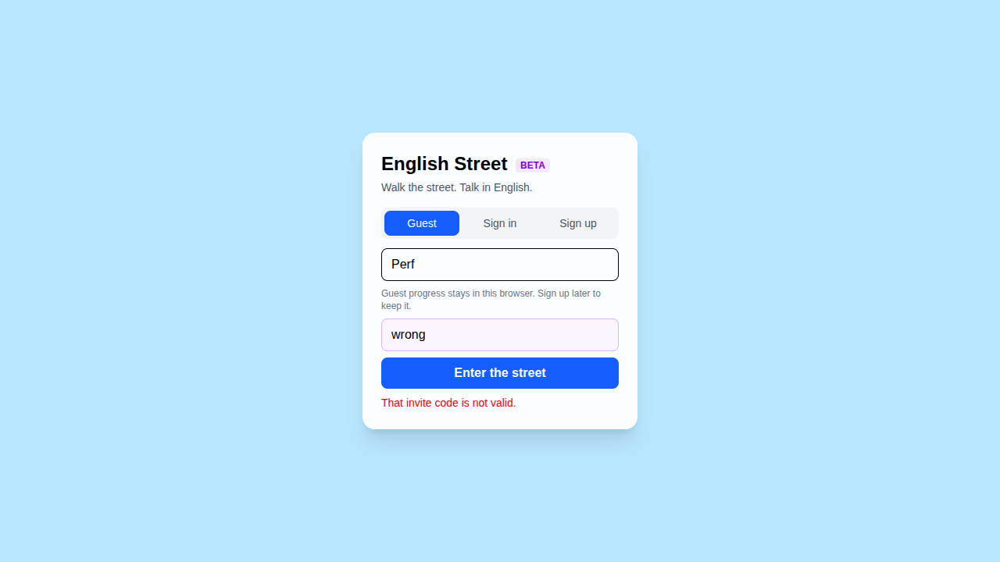

# English Street

Game học tiếng Anh đa người chơi: người chơi đi dạo trên một con phố 3D low-poly,
trò chuyện bằng tiếng Anh (gõ hoặc nói) với các NPC chủ cửa hàng và với người chơi khác.

Thiết kế đầy đủ: [docs/GDD.md](docs/GDD.md).


**Điều khiển:** WASD / mũi tên di chuyển · Shift chạy · E nói chuyện với NPC · Enter mở chat · Esc đóng.
Trong hội thoại: nhấn giữ 🎤 để nói (Chrome/Edge/Safari), thả ra rồi sửa transcript nếu cần và Send; 🔊 phát lại câu NPC; nút loa ở header để tắt tiếng.
Với người chơi khác: phím 1-5 emote; nút "🎙️ Voice" bật voice chat gần (WebRTC P2P, nghe được trong ~8 m); ⚑ cạnh tin nhắn để report.
Quest cặp đôi: gặp Lucas ở Le Petit Bistro, chọn "Dinner for Two", mời một người chơi đang đứng gần; một người làm khách, một người làm phục vụ, Lucas chấm từng câu.


Trên mobile: joystick ảo góc trái, chạm nút "Tap to talk" khi đứng gần NPC.

Asset 3D (CC0): xem [apps/web/public/models/CREDITS.md](apps/web/public/models/CREDITS.md).

## Cấu trúc

```
apps/web          React + React Three Fiber client (Vite)
apps/api          Fastify REST API + Prisma + Claude (NPC AI)
apps/game-server  Colyseus realtime server (vị trí, chat gần)
packages/shared   Zod schemas + types dùng chung
packages/quests   Nội dung NPC persona + quest (YAML)
infra             docker-compose dev (Postgres, Redis) + Dockerfile, compose production, Caddy
docs              GDD, DEPLOY.md, ảnh chụp
```

## Chạy dev

```bash
cp .env.example .env            # điền ANTHROPIC_API_KEY
pnpm install
pnpm db:up                      # Postgres + Redis (cần Docker)
pnpm --filter @es/api prisma migrate dev
pnpm dev                        # web :5173, api :4000, game-server :2567
```

Các app Node (`api`, `game-server`) chạy trực tiếp TypeScript bằng `tsx` (cả dev lẫn prod);
`pnpm build` của chúng chỉ typecheck. Client web build bằng Vite ra `apps/web/dist`.

```bash
```

Không có Docker: API tự chuyển sang lưu trữ in-memory khi không kết nối được Postgres/Redis
(đủ để chơi thử, mất dữ liệu khi restart).

## NPC AI

NPC trò chuyện bằng Claude (`claude-opus-5-5`, structured output). Cần API key từ
https://platform.claude.com (tính phí theo token, **không** dùng được gói Claude Pro/Max của claude.ai).

| `NPC_PROVIDER` | Hành vi |
|---|---|
| `auto` (mặc định) | Dùng Claude nếu `ANTHROPIC_API_KEY` thật, ngược lại dùng mock |
| `claude` | Bắt buộc Claude, lỗi nếu thiếu key |
| `mock` | NPC giả lập cục bộ theo từ khoá, không tốn phí, dùng để dev/test UI |

Kiểm tra chất lượng hội thoại với 20 kịch bản mẫu (đúng goal, không nói tiếng Việt, có hint khi bí):

```bash
pnpm --filter @es/api eval:npc                      # provider theo .env
NPC_PROVIDER=claude pnpm --filter @es/api eval:npc  # chấm model thật
```


### Chống đốt token

| Biến | Mặc định | Ý nghĩa |
|---|---|---|
| `NPC_MODEL_BASIC` | `claude-haiku-5-5` | Model cho quest A1–A2 và chat tự do (B1+ dùng `NPC_MODEL`) |
| `NPC_DAILY_TURNS_PER_PLAYER` | 60 | Lượt NPC mỗi người mỗi ngày (theo IP: gấp 3) |
| `NPC_DAILY_BUDGET_USD` | 5 | Trần chi tiêu ước tính mỗi ngày cho cả hệ thống; chạm trần thì NPC nghỉ đến hôm sau |
| `NPC_HISTORY_MAX` | 10 | Số tin nhắn gần nhất gửi lên model |

Xem mức chi hôm nay: `GET /admin/budget` (header `authorization: Bearer $ADMIN_TOKEN`). Ngoài ra hãy đặt spend limit cho workspace trên console Anthropic.
Khi có Redis, các bộ đếm này dùng chung cho mọi instance API.

## Tài khoản và tiến trình

Chơi khách (tiến trình gắn với trình duyệt) hoặc đăng ký email + mật khẩu (tiến trình khách được chuyển sang tài khoản).
Sau khi vào: bài test 10 câu xếp trình độ CEFR, hồ sơ XP/level/coins/streak/huy hiệu, 3 quest ngày có thưởng thêm,
sổ tay từ vựng tự lưu từ hội thoại với ôn tập flashcard, và shop màu avatar. Đặt `AUTH_SECRET` thật trong `.env` khi deploy.

## Hiệu năng

- Tile phố vẽ bằng `InstancedMesh` (một draw call cho mỗi cặp model/mesh), nhà cửa hàng giữ màu riêng.
- Nút ⚙️ High/Low: Low tắt bóng, pixel ratio 1, không antialias, chỉ vẽ người chơi trong 28 m; mặc định Low trên thiết bị cảm ứng.
- Người chơi xa hơn 45 m không được vẽ, name tag chỉ trong 22 m; cảnh 3D chỉ tải sau màn đăng nhập.
- Đo trên Chromium headless (1280×720): High 391 draw call, Low 210 (trước giai đoạn 6: 567 / 249). `window.__esPerf` giữ mẫu FPS/draw call mới nhất.



## Analytics, góp ý, beta kín

- Mọi sự kiện quan trọng (vào phố, lượt NPC, quest bắt đầu/kết thúc, quest cặp đôi, voice, report, FPS) ghi vào bảng `Event`.
  Xem tổng hợp: `GET /admin/stats?days=7` với header `authorization: Bearer $ADMIN_TOKEN` (không đặt token: mở ở dev, đóng ở production).
- Nút 💬 Feedback trong game ghi vào bảng `Feedback` → `GET /admin/feedback`; report người chơi → `GET /admin/reports`.
- `BETA_CODES=ma1,ma2` bật beta kín: màn đăng nhập hỏi mã mời, mã hợp lệ đổi lấy pass 90 ngày; API và game-server đều kiểm tra.



## Deploy

Một VPS + Docker Compose + Caddy (HTTPS tự động), xem [docs/DEPLOY.md](docs/DEPLOY.md):

```bash
cp .env.example .env   # AUTH_SECRET, ADMIN_TOKEN, POSTGRES_PASSWORD, domain, ANTHROPIC_API_KEY
docker compose --env-file .env -f infra/docker-compose.prod.yml up -d --build
```

Load test game-server: `BOTS=50 SECONDS=30 pnpm --filter @es/game-server load:bots` (50 bot: p95 45 ms, CPU 12 %).

## Mobile

The web client has a touch HUD (joystick, Talk button, bottom sheets, keyboard-safe inputs) and is installable
as a PWA (Add to Home Screen). See `docs/PERF.md` for the layout notes and draw-call budget.

## Settings, Vietnamese subtitles, IPA (Step 2 / phase 8)

- ⚙️ **Settings** sheet: Vietnamese subtitles (auto = on for A1–A2), IPA line, NPC voice + speed, voice chat,
  graphics quality, ambient volume. Stored in `localStorage` (`es:subs2`, `es:ipa`, `es:ttsRate`, `es:ambient`).
- **Subtitles**: the chat request carries `subtitles: true`; the NPC structured output then fills `reply_vi`
  (same Claude call, measured at ≈ +0.0001 USD per turn on Haiku). Static text (greetings, nearby chat,
  single words) goes through `POST /translate`, a Haiku call cached in Redis for 30 days by text hash.
- **IPA**: `GET /dict/ipa?words=a,b` from CMUdict (BSD, `apps/api/data/cmudict.dict.gz`, US English,
  ARPAbet → IPA with stress marks). No LLM involved. Tap any word in an NPC line for IPA + meaning + 🔊 + save to notebook (`POST /me/vocab`).
- `/admin/stats` → `learning`: subtitle turns, word taps, chat translations, settings changes.

## Talking to other players (Step 2 / phase 9)

- **Tap a player** → popup: *Request to talk*, wave, report. The other side gets Accept / Not now.
  A talk is a private text channel (server-relayed, profanity-masked, nobody else receives it) plus voice:
  the requester's microphone is used if on, the partner auto-joins the voice mesh in **listen-only** mode
  (no mic permission needed) and can turn their own mic on from the talk box. The server (`StreetRoom`) is the
  referee: both players must be within `PROXIMITY_RADIUS + INTERACT_RADIUS`, neither already in a talk,
  and the talk ends when they drift beyond `TALK_DROP_RADIUS` or one of them leaves.
- **Shout** 📢: a text shout (toggle next to the chat input) is delivered to everyone within `SHOUT_RADIUS`
  (24 m vs 8 m for normal chat), shown as a big red bubble, limited to one per 5 s per player. Holding the
  📢 button shouts with your voice: your `shouting` flag is in the room state, and every player within the
  radius connects to you at full volume (listen-only if they had voice off); releasing drops the extra connections.
- Status dots next to names: red = shouting, green = talking with you, grey = talking with someone else.
- Load test: `BOTS=50 SECONDS=30 SHOUT_RATE=0.002 pnpm --filter @es/game-server load:bots` (≈10 % of bots
  shouting per minute) measured 12 % CPU on the dev VPS, same as without shouts.

## NPC characters (Step 2 / phase 10)

Each shopkeeper is a Quaternius CC0 human (`public/models/characters/*.glb`, 7 base models, ~500 KB each after
`pnpm --filter @es/web build:models`: unused clips removed, meshopt-compressed). `scene/npcLook.ts` maps every NPC
to a model plus **material recolours** (the stock outfit becomes a uniform: white coat, green store vest, grey suit…)
and **procedural accessories** attached to bones (`scene/Human.tsx`): barista cap, postal cap, sun hat, name badge,
stethoscope, bow tie, apron. Bone-space objects are scaled by the inverse bone world scale (the rigs use ~95×).
Since Step 4 the game draws chibi characters instead (see *Character creator*); this pipeline remains for the dev preview.
Preview any look without joining the game: `http://localhost:5173/dev/preview.html?npcs=barista,doctor` (dev only).

## Street life (Step 2 / phase 11)

- **Cats and dogs** (`world/critters.ts`, `scene/Critters.tsx`): 3 cats + 2 dogs (chibi animals built in code, `scene/chibi/buildCritter.ts`: round body, big head and eyes,
  own fur colours, procedural walk / idle / nap / happy-wag animation, 7 draw calls each) follow fixed waypoint
  loops with pauses. Positions are a pure function of the **server clock** (the room sends its `Date.now()` on join),
  so every client sees the same animal in the same place with zero network traffic. Tap one: it reacts, says an English
  sentence (TTS) and the key word (cat, dog, fountain, park…) is saved to the notebook once per session.
- **Pet labels**: within 4 m (or when tapped) every animal shows its English word and name above it, e.g. `dog - Luna`.
- **Hug a pet** (`world/hold.ts`): cats, dogs, rabbits and ducks (two rabbits live in the park; Daisy's duck family swims
  along the near bank and the walkable area now reaches the grass bank, z ≤ 17.2, ducks within 2.6 m). Walk up to one
  (≤ 1.7 m) and press **F** / tap 🤗 *Hug*. `MSG.HOLD` sets
  `Player.holding` (server keeps one holder per critter); every client then hides that critter's scheduled body and draws
  it cradled in the holder's arms (`HeldCritter` in the avatar group: dangling paws, fast wag, looking at you), and the
  chibi wraps its arms around it while still walking. Put it down (F again): it lands in front of you, stays there for 20 s, then walks / hops back to its route at its own speed; ducks put down on land waddle-run straight back to the river right away.
- **Ducks and rabbits** (same system as the cats and dogs, so they are tappable with a sentence + notebook word and a
  WebAudio quack / squeak): two duck families swim loops on the river (`DUCK_Y`, ducklings share the mother's loop with a
  smaller time offset so they paddle in a line; head dips under now and then), four rabbits hop around the meadow beyond
  the far bank and the grass outside both end fences (hopping arcs, nose/ear twitch, naps).
- **Shop signs** sit at most 3.1 m up (just above the door), so the tall buildings' signs stay in the camera view.
- **Street beyond the fences** (`Horizon.tsx` backdrop): the same road / lamp-post / pavement / park tiles continue past
  both end fences up to tx ±38 (±32 on low), so the street runs to the horizon instead of ending in a blank strip.
- **Flowers and grass** (`scene/Flora.tsx`): seeded scatter over the grass tiles, one InstancedMesh per source mesh
  (9 draw calls); density 5+8 per tile on high, 2+3 on low. Textures were downsized to 256² WebP by the model build.
- **Collision** (Step 3): besides the shop AABBs, `resolveMove` takes circle colliders: lamp posts (from the
  `road-straight-lightposts` tiles), NPCs, critters, cyclists and other players (`LocalPlayer` collects the ones within 4 m
  each frame). A circle only blocks a step that moves closer to it, so nothing can trap you; glancing contact slides around
  it; cats and dogs can be jumped over; movement is sub-stepped (≤ 0.15 m) so slow frames cannot tunnel through a post.
- **Critters and cyclists avoid players** (Step 3, `world/avoid.ts`): each client offsets the scheduled pose away from
  players it can see (local + remote server positions). Walking critters side-step perpendicular to their path, resting
  ones shuffle aside, cyclists swerve laterally (up to 2.6 m, steering into it) for anyone within 7 m ahead. The drawn
  positions go to `livePos`, which the local player's collision uses, so you bump into what you see.
- **Per-line Dịch / IPA** (Step 3): NPC lines no longer auto-translate. Each line has a *Dịch* button (translation via the
  cached `/translate`, only when tapped) and an *IPA* button; ⚙️ keeps "always show" switches, both off by default.
- **Cyclists** (Step 3, `world/cyclists.ts` + `scene/Cyclists.tsx`): three riders pass along the road on fixed periods
  (58/73/91 s), evaluated from the server clock like the critters, so all clients see the same pass and the server does
  nothing. Riders are chibi characters with bike helmets (same builder as the players) on a small chunky cartoon bike
  (`BS` = 0.66 of the old adult bike, front basket); the bike is one merged mesh, wheels and cranks are shared
  InstancedMeshes, the rider is a jointed rig posed per frame (pedalling legs, arms on the bars). Passing within 6 m
  rings a bell (WebAudio) and shows "On your left!"; tapping a rider opens the same card as the critters (sentence, word
  saved to the notebook, TTS). Low quality shows one rider. The road is closed by a fence at each end
  (`END_FENCE_X`): riders stop, get off, hold the bike up beside them and hop over the rail, then ride on (`pose.carry` in the schedule).
- **Horizon** (Step 3, `scene/Horizon.tsx`): replaces the flat green plane. North: two rows of backdrop houses (instanced
  Kenney buildings with per-instance colour multipliers) and gardens; south: a river with a cheap analytic-ripple water shader
  (fog-aware, no reflections), ducks, two sail boats and footbridges; all around: endless farmland painted by the ground
  shader (strips, furrows, hedges), fences, hay bales and tree clusters; sky fog in `HORIZON_COLOR` plus drifting cloud
  sprites. Everything is seeded/server-clock driven, so all clients see the same landscape. Low quality: flat water, no
  clouds/boats, fewer trees.
- **Zones** (Step 3): every zone is a Colyseus room of the `street` type with up to 100 players. "Enter the street"
  joins or creates a public *Main Street* (`joinOrCreate` filtered by `zoneKind: 'main'`; a full one spawns *Main Street 2*).
  "Choose or create a zone…" opens the picker (`ui/ZoneScreen.tsx`): join a listed zone, create a named one (optionally
  private with a 4–8 character code checked in `onJoin`), or follow an invite link `?zone=<id>[&code=…]`. The list comes
  from `GET /zones` on the game server (`/ws/zones` behind nginx); custom zones auto-dispose when empty. The zone chip in
  the HUD shows name + head count, copies the invite link and switches zones.
- **Jump** (Step 3): Space on desktop, the ⤒ button next to the joystick on phones. Vertical motion is simulated on the
  client (`JUMP_SPEED`/`GRAVITY` in `@es/shared`), sent as `y` with each input and clamped by the server; remote players
  interpolate `y` and play the robot's one-shot `Jump` clip.
- **Ambient sound** (`audio/ambient.ts`): occasional procedural bird chirps (no continuous noise bed) and critter voices via WebAudio
  (no audio files). Follows the ⚙️ ambient slider; default 40 % on desktop, off on phones.
- Draw calls after this phase: high 286 (budget 450), low 133 (budget 250).

## Mobile app (Step 2 / phase 12)

`apps/mobile` is a Flutter shell (Android + iOS) around the web game: WebView + native speech recognition /
TTS bridge (needed on iOS), microphone permission for voice chat, haptics, offline Notebook, app settings,
push-token registration (`POST /me/push-token`). Build with `flutter build apk --release`; CI builds APK/AAB
in `.github/workflows/mobile.yml`. Details, store checklist and the bridge protocol: `docs/MOBILE.md`.

## Character creator (Step 4) — chibi characters

Every character (players and shopkeepers) is an original **chibi** built in code (`apps/web/src/scene/chibi/`): big round
head, round body, short limbs, big eyes with highlights, rosy cheeks, toon shading (3-step gradient) and an
inverted-hull outline on high quality. No GLB, no skeleton: `buildChibi.ts` merges each body part (head + face + hair +
hat + glasses, torso + outfit details + bag, each arm, each leg) into one vertex-coloured geometry, cached per look, so a
character is 6 draw calls (+6 outline) whatever it wears. `Chibi.tsx` animates the joints procedurally (idle breathing,
walk/run cycle, wave, talk/yes nod, no shake, thumbs up, dance, jump pose). Height ≈ 1.5 m (`CHIBI_SCALE`).
Lineup page for screenshots (dev only): `http://localhost:5173/dev/chibi.html?set=bodies|hair|hats|npcs`.

Players design theirs by picking (🎨 **Character** in the HUD; it opens by itself on the first visit, after the level
test). The look (`packages/shared/src/avatar.ts`):

- **Outfit**: T-shirt & shorts, Hoodie, Suit (+ tie colour), Overalls, Dress (+ belt colour), or Robot.
- **Skin** (8 tones), **hairstyle** (short, spiky, curly, bob, long, ponytail, buns, bald) and **hair colour** (10).
- **Clothes colours** from an 18-colour palette for top / bottom / shoes.
- **Extras**: cap, beanie, sun hat, top hat, crown, glasses, sunglasses, backpack.
- Some items cost coins (sun hat 40, top hat 80, crown 150, sunglasses 40, backpack 30, 2 hair colours, 3 clothes colours).
  Everything can be tried on in the preview; **Buy & save** pays only when saving. Old robot-colour saves migrate
  (`{ color, owned }` → top colour, bought colours stay owned).

Shopkeeper uniforms are `NPC_CHIBI` in `scene/npcLook.ts` (apron, badge, stethoscope, bow tie, paper hat extras).
The preview is a second small R3F canvas (drag to turn, pinch/scroll to zoom; the camera glides to the face on the
*Skin & hair* and *Extras* tabs). Saving calls `POST /me/avatar` (every colour must be in its palette, paid items must be
owned → 402 `not_owned`), then sends `MSG.AVATAR` so the room updates `Player.avatar` live (server re-validates with
`parseLook`, max one change per 0.8 s).
