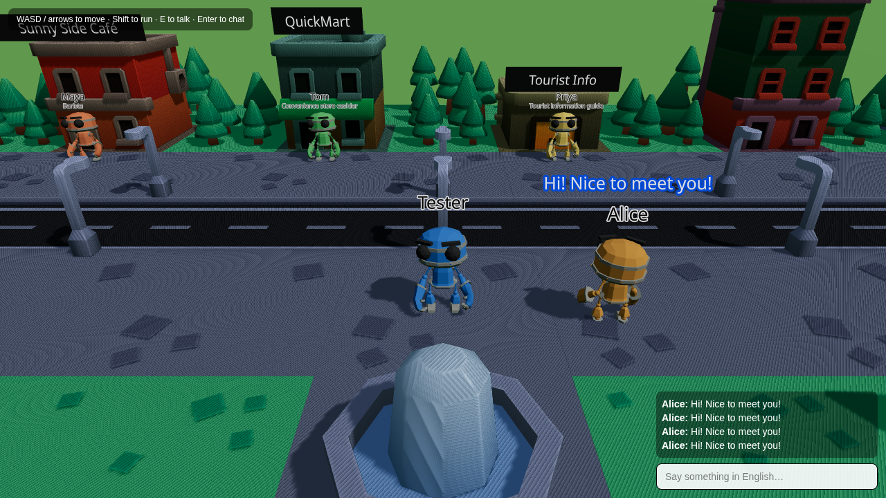
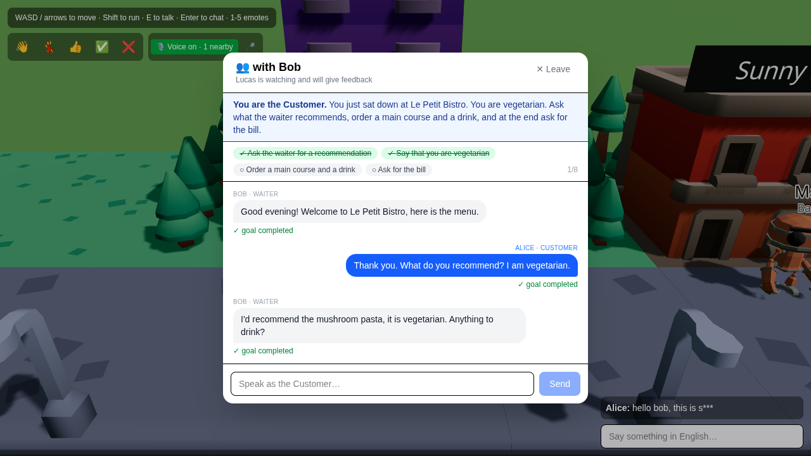
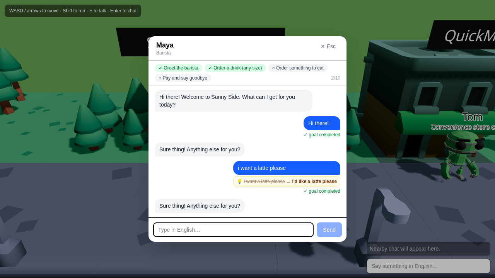

# English Street

Game học tiếng Anh đa người chơi: người chơi đi dạo trên một con phố 3D low-poly,
trò chuyện bằng tiếng Anh (gõ hoặc nói) với các NPC chủ cửa hàng và với người chơi khác.

Thiết kế đầy đủ: [docs/GDD.md](docs/GDD.md).



**Điều khiển:** WASD / mũi tên di chuyển · Shift chạy · E nói chuyện với NPC · Enter mở chat · Esc đóng.
Trong hội thoại: nhấn giữ 🎤 để nói (Chrome/Edge/Safari), thả ra rồi sửa transcript nếu cần và Send; 🔊 phát lại câu NPC; nút loa ở header để tắt tiếng.
Với người chơi khác: phím 1-5 emote; nút "🎙️ Voice" bật voice chat gần (WebRTC P2P, nghe được trong ~8 m); ⚑ cạnh tin nhắn để report.
Quest cặp đôi: gặp Lucas ở Le Petit Bistro, chọn "Dinner for Two", mời một người chơi đang đứng gần; một người làm khách, một người làm phục vụ, Lucas chấm từng câu.


Trên mobile: joystick ảo góc trái, chạm nút "Tap to talk" khi đứng gần NPC.

Asset 3D (CC0): xem [apps/web/public/models/CREDITS.md](apps/web/public/models/CREDITS.md).

## Cấu trúc

```
apps/web          React + React Three Fiber client (Vite)
apps/api          Fastify REST API + Prisma + Claude (NPC AI)
apps/game-server  Colyseus realtime server (vị trí, chat gần)
packages/shared   Zod schemas + types dùng chung
packages/quests   Nội dung NPC persona + quest (YAML)
infra             docker-compose (Postgres, Redis)
```

## Chạy dev

```bash
cp .env.example .env            # điền ANTHROPIC_API_KEY
pnpm install
pnpm db:up                      # Postgres + Redis (cần Docker)
pnpm --filter @es/api prisma migrate dev
pnpm dev                        # web :5173, api :4000, game-server :2567
```

Các app Node (`api`, `game-server`) chạy trực tiếp TypeScript bằng `tsx` (cả dev lẫn prod);
`pnpm build` của chúng chỉ typecheck. Client web build bằng Vite ra `apps/web/dist`.

```bash
```

Không có Docker: API tự chuyển sang lưu trữ in-memory khi không kết nối được Postgres/Redis
(đủ để chơi thử, mất dữ liệu khi restart).

## NPC AI

NPC trò chuyện bằng Claude (`claude-opus-5-5`, structured output). Cần API key từ
https://platform.claude.com (tính phí theo token, **không** dùng được gói Claude Pro/Max của claude.ai).

| `NPC_PROVIDER` | Hành vi |
|---|---|
| `auto` (mặc định) | Dùng Claude nếu `ANTHROPIC_API_KEY` thật, ngược lại dùng mock |
| `claude` | Bắt buộc Claude, lỗi nếu thiếu key |
| `mock` | NPC giả lập cục bộ theo từ khoá, không tốn phí, dùng để dev/test UI |

Kiểm tra chất lượng hội thoại với 20 kịch bản mẫu (đúng goal, không nói tiếng Việt, có hint khi bí):

```bash
pnpm --filter @es/api eval:npc                      # provider theo .env
NPC_PROVIDER=claude pnpm --filter @es/api eval:npc  # chấm model thật
```


